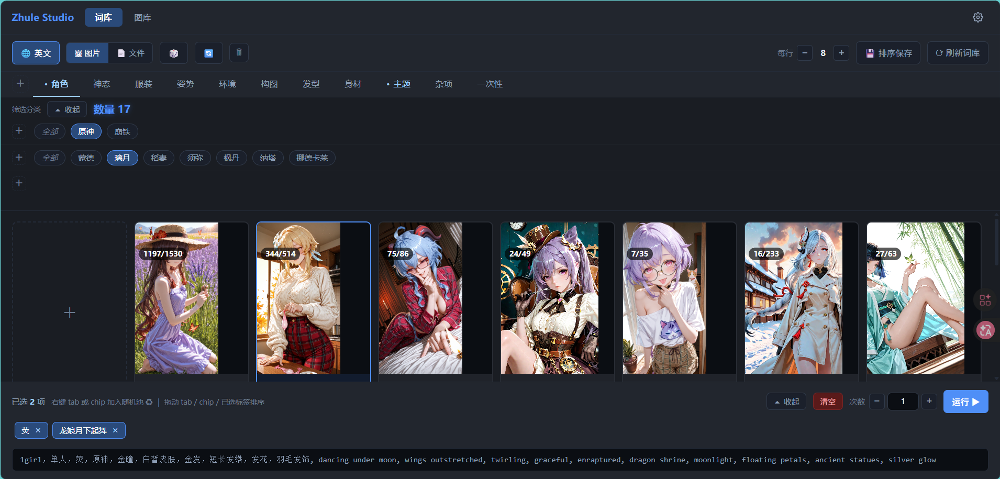
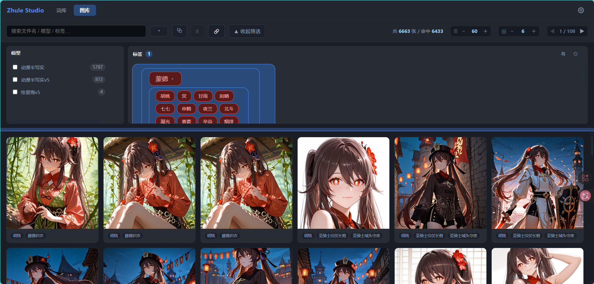
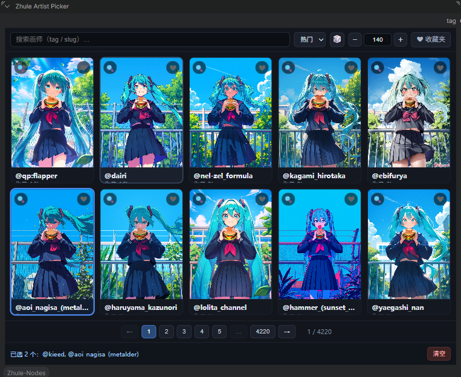

---
AIGC:
    Label: "1"
    ContentProducer: 001191440300708461136T1XGW3
    ProduceID: f31316edd1bc287d4516025481a71e55_d62202a9c96911f18b7f525400393706
    ReservedCode1: DU75vGyh8UYFVvs4tW8QaqDizc7HbACunOQvob28TKsj4iVPOTowhCUZs6bh44sKxoRqhhOpJvEMPNcJOfcoR10kYmSdb0eG+dz1mD4ej4R6BHzWH0LyMk85k8LvkmqGweNd0QWlTmDIuslqf6zKs+8vNXk4jT3bdd/9J2VjPjp1A6HFiZ7L4Bp3ZGE=
    ContentPropagator: 001191440300708461136T1XGW3
    PropagateID: f31316edd1bc287d4516025481a71e55_d62202a9c96911f18b7f525400393706
    ReservedCode2: DU75vGyh8UYFVvs4tW8QaqDizc7HbACunOQvob28TKsj4iVPOTowhCUZs6bh44sKxoRqhhOpJvEMPNcJOfcoR10kYmSdb0eG+dz1mD4ej4R6BHzWH0LyMk85k8LvkmqGweNd0QWlTmDIuslqf6zKs+8vNXk4jT3bdd/9J2VjPjp1A6HFiZ7L4Bp3ZGE=
---

# ComfyUI-Zhule-Nodes

> 给 ComfyUI 装上「中文词库 + 图片图库 + 画师选择器」的一体化工具箱，让你告别手敲英文提示词。

这个插件为 ComfyUI 提供三个贴心能力：

- **中文提示词词库**：网页里点卡片选词，中文看着选，自动拼成英文提示词喂给模型
- **图片图库**：出图自动归档，网页浏览、筛选、打标签、找图一键还原工作流
- **画师选择器**：节点面板里直接搜索、收藏、随机挑画师，画风 tag 自动生成

如果你是刚接触 ComfyUI 的新手，跟着下面的教程走，5 分钟就能上手。

---

## 一、安装

1. 把 `ComfyUI-Zhule-Nodes` 整个文件夹放进 ComfyUI 的 `custom_nodes` 目录
2. 完全关闭 ComfyUI，重新启动
3. 启动完成后，节点菜单里会出现 `Zhule` 分类

> 不需要额外安装任何依赖，开箱即用。

---

## 二、中文提示词词库（推荐先看这个）

### 2.1 打开词库

在画布上添加 **`ZhuleStudio`（提示词管理器）** 节点，点击节点上的「词库」按钮即可打开词库页面，无需手动输入网址。

打开后就是词库界面（见下图），提示词按分类整理成卡片，点击就能选中。



### 2.2 词库分类

词库自带十大分类，覆盖常用出图要素：

| 分类 | 内容 |
|------|------|
| 01_角色 | 角色设定、职业、种族等 |
| 02_身材 | 体型、姿态特征 |
| 03_发型 | 发色、发型 |
| 04_神态 | 表情、情绪、眼神 |
| 05_服装 | 服饰、配饰 |
| 06_姿势 | 动作、站姿坐姿 |
| 07_环境 | 场景、背景、天气 |
| 08_杂项 | 其他常用词 |
| 09_构图 | 镜头、视角、画面构图 |
| 10_主题 | 主题风格、整体氛围 |

### 2.3 怎么用

1. 在 ComfyUI 画布上添加 **`ZhuleStudio`（提示词管理器）** 节点
2. 节点上有一个「ID」输入框，随便填一个名字（比如 `my_prompt_1`），**必须手动填写且保证各工作流间唯一**
3. 点击节点上的「词库」按钮打开词库网页，在顶部找到对应的 ID，点开它
4. 在词库里点选想要的提示词卡片，选中的词会实时同步到画布节点上
5. 点「生成」，节点会直接输出正面和负面提示词给模型

> 词库网页里选词后，画布上对应节点会实时更新，不需要手动复制粘贴。

### 2.4 管理自己的词库

- 词库目录就是插件里的 `prompt` 文件夹，按 `01_角色`、`02_身材` 这样的命名来组织
- 想加词：在对应分类下新建 `.txt` 文件，一个文件就是一张卡片
- 想让卡片配图：在卡片文件夹里放一张图片，或者新建 `images.txt` 按行写图片路径
- 中文名（可选）：在卡片文件夹里放一个 `prompt_cn.txt` 写中文说明

---

## 三、图片图库

### 3.1 自动归档

用插件自带的 **`ZhuleSaveImage`（保存图片）** 节点出图，图片会自动保存到 ComfyUI 的 `output/zhule_img` 文件夹，并按序号自动命名，不用你手动整理。

### 3.2 打开图库

在画布上添加 **`ZhuleStudio`（提示词管理器）** 节点，点击节点上的「图库」按钮即可打开图库页面，无需手动输入网址。若节点已填写 ID，图库会按该 ID 自动过滤出本节点的出图。



### 3.3 图库能做什么

- **浏览**：分页浏览所有出图，缩略图按需加载，图片再多也不卡
- **筛选**：按模型、LoRA、标签筛选图片，快速找到想要的那一张
- **详情**：点击图片查看大图，能看到这张图的模型、LoRA、提示词等信息
- **还原工作流**：详情页把工作流拖回画布，就能一键还原这张图的生成参数，方便复刻和微调
- **打标签**：给图片手动添加标签，方便日后搜索分类
- **删除**：不想要的图可以直接删掉

> 图片多的时候如果列表还是旧数据，点一下图库里的「刷新索引」按钮，等待几秒就会自动更新。

---

## 四、画师选择器

在画布上添加 **`ZhuleArtistPicker`（画师选择器）** 节点，节点面板里会内嵌一个画师选择界面（见下图）。



- **搜索**：输入关键字快速找画师
- **收藏**：把常用画师收进收藏夹，下次直接点
- **随机**：不知道画什么风格？随机挑一个
- **多选**：可以同时选多个画师
- 选好后节点输出带 `@` 前缀的画师 tag，直接连进提示词就能用

---

## 五、其他实用节点

`Zhule` 分类下还附带这些常用小工具：

| 节点名称 | 用途 |
|----------|------|
| `ZhuleCheckpointLoader` | 加载主模型（大模型），带常用采样器/调度器快捷选项 |
| `ZhuleLoraLoader` | 加载 LoRA 模型，支持权重设置 |
| `ZhuleLatentSize` | 一键设置常用出图尺寸（1:1、3:2、2:3、4:3 等） |
| `ZhuleTextConcatenate` | 拼接多路文本，最多 16 路，自动加分隔符 |
| `ZhuleTextReplace` | 对文本做正则替换，批量改词 |
| `ZhulePass` | 条件开关：条件为真输出文本，为假输出空 |
| `ZhuleProbability` | 概率开关：按百分比随机保留或丢弃文本，适合随机抽词 |

---

## 六、常见问题

**Q：网页打不开？**
确认 ComfyUI 已经启动，并且端口是默认的 8188。如果改了端口，把网址里的 8188 换成你的端口。

**Q：词库选词了，画布节点没变化？**
检查节点上的「ID」是否填写，且和词库网页顶部选的 ID 一致。改完 ID 后建议刷新一下网页。

**Q：图库看不到新出的图？**
点图库右上角的「刷新索引」按钮，等提示重建完成即可。如果还不行，先 Ctrl+F5 强制刷新浏览器页面。

**Q：画师选择器里没有我想找的画师？**
画师名单维护在插件的 `modules/artist_picker/artists.json` 文件里，可以按里面的格式自行添加。

**Q：保存的图片去哪了？**
固定保存在 ComfyUI 的 `output/zhule_img` 文件夹，文件名形如 `zhule_0001.png`。

---

## 七、目录说明（给想自己改内容的人）

```
ComfyUI-Zhule-Nodes/
├─ prompt/                  # 中文词库内容（按分类放 txt）
├─ modules/
│  ├─ studio/               # 词库 + 图库网页
│  └─ artist_picker/        # 画师选择器（artists.json 画师名单）
└─ output/zhule_img/        # 出图自动归档目录（在 ComfyUI output 下）
```

> 只改内容不碰代码：往 `prompt` 里加词条、往 `artists.json` 里加画师，都是纯文本操作，安全简单。
