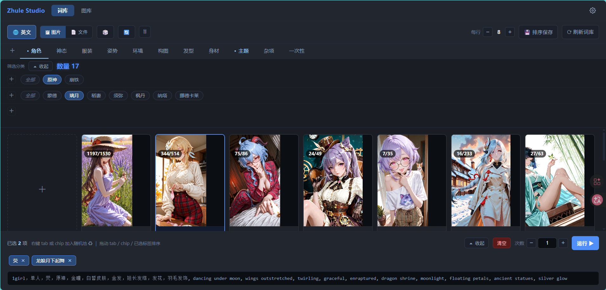
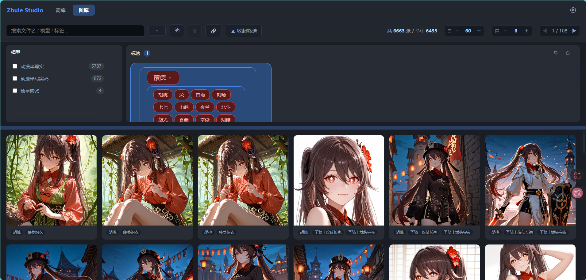
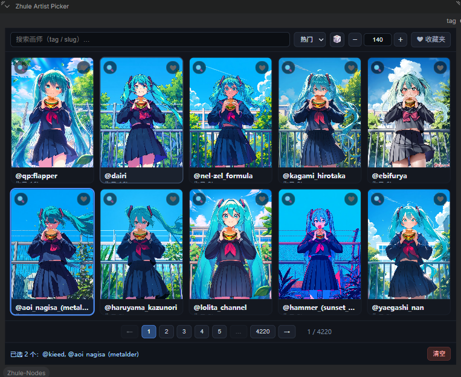

# ComfyUI-Zhule-Nodes

> 给 ComfyUI 装上「中文词库 + 图片图库 + 画师选择器」的一体化工具箱，让你告别手敲英文提示词。

这个插件为 ComfyUI 提供三块核心能力：

- **中文提示词词库**：网页里点卡片选词，中文看着选，自动拼成英文提示词喂给模型；词条可在网页里直接编辑、删除、配参考图
- **图片图库**：出图自动归档，网页浏览、筛选、打标签、找图一键还原工作流
- **画师选择器**：节点面板里直接搜索、收藏、随机挑画师，画风 tag 自动生成

另外附带一批实用小节点（随机采样参数、LoRA 加载、文本拼接/替换、概率门控等），全部集中在 `Zhule` 分类下。

如果你是刚接触 ComfyUI 的新手，跟着下面的教程走，5 分钟就能上手。

---

## 一、安装

1. 把 `ComfyUI-Zhule-Nodes` 整个文件夹放进 ComfyUI 的 `custom_nodes` 目录
2. 完全关闭 ComfyUI，重新启动
3. 启动完成后，节点菜单里会出现 `Zhule` 分类

> 不需要额外安装任何依赖，开箱即用。

---

## 二、中文提示词词库（推荐先看这个）

### 2.1 打开词库

在画布上添加 **`ZhuleStudio`（提示词管理器）** 节点，点击节点上的「词库」按钮即可打开词库页面；也可以直接在浏览器访问 `http://127.0.0.1:8188/zhule_studio`。

打开后就是词库界面（见下图），提示词按分类整理成卡片，点击就能选中。

### 2.2 词库分类

词库自带十大分类，覆盖常用出图要素：

| 分类 | 内容 |
|------|------|
| 01_角色 | 角色设定、职业、种族等 |
| 02_身材 | 体型、姿态特征 |
| 03_发型 | 发色、发型 |
| 04_神态 | 表情、情绪、眼神 |
| 05_服装 | 服饰、配饰 |
| 06_姿势 | 动作、站姿坐姿 |
| 07_环境 | 场景、背景、天气 |
| 08_杂项 | 其他常用词 |
| 09_构图 | 镜头、视角、画面构图 |
| 10_主题 | 主题风格、整体氛围 |

分类和词条都可以在词库网页里直接增删改，不需要碰任何文件。

### 2.3 怎么用

1. 在 ComfyUI 画布上添加 **`ZhuleStudio`（提示词管理器）** 节点
2. 节点上有一个「ID」输入框，随便填一个名字（比如 `my_prompt_1`），**必须手动填写且保证各工作流间唯一**
3. 点击节点上的「词库」按钮打开词库网页，在顶部找到对应的 ID，点开它
4. 在词库里点选想要的提示词卡片，选中的词会实时同步到画布节点上
5. 点「生成」，节点会直接输出正面和负面提示词给模型

> 词库网页里选词后，画布上对应节点会实时更新，不需要手动复制粘贴。

### 2.4 词条管理

- **编辑词条**：点击卡片即可弹出编辑面板，可修改英文提示词、中文说明、负面词等
- **删除词条**：编辑面板右上角红叉或卡片删除按钮即可删除，删错可随时恢复
- **免确认开关**：在设置面板里打开「删除免确认」后，删除词条不再弹确认框，操作更顺滑
- **参考图**：每张词条卡片可以上传多张参考图（优先展示），放大查看器里可以左右切换、随机跳转
- **遍历补图**：词库页提供「遍历模式」，按当前参考图最多的词条为基准，自动补跑生成任务，集中把一批词条的参考图补齐
- **跳转图库**：词条卡片上点击进入详情，可直接跳转到图库并按该词条过滤出相关出图，方便对比参考图与真实成图

---

## 三、图片图库

### 3.1 自动归档

用插件自带的 **`ZhuleSaveImage`（保存图片）** 节点出图，图片会自动保存到 ComfyUI 的 `output/zhule_studio/zhule_img` 文件夹，按序号自动命名（`zhule_0001.png`）；保存、删图、打标签都会即时同步图库，不需要额外手动刷新。

### 3.2 打开图库

在画布上添加 **`ZhuleStudio`（提示词管理器）** 节点，点击节点上的「图库」按钮即可打开图库页面。若节点已填写 ID，图库会按该 ID 自动过滤出本节点的出图。

### 3.3 图库能做什么

- **浏览**：分页浏览所有出图，缩略图按需加载；支持拖动框选 / Ctrl+点击 多选
- **筛选**：按模型、LoRA、标签筛选图片；顶部**外部过滤区**列出已选标签条，可随时增删
- **详情**：点击图片查看大图，能看到这张图的模型、LoRA、提示词、标签等信息
- **还原工作流**：详情页把工作流拖回画布，就能一键还原这张图的生成参数，方便复刻和微调
- **打标签**：给图片手动添加词库词条标签或自定义标签（自定义标签支持 `/` 层级路径，如 `角色/绝区零/妮可`，多个用英文逗号分隔）
- **删除**：单张删除或批量删除均有确认弹窗（同样遵循免确认开关），删除会同时移除图片文件与缩略图
- **硬链接导出**：把选中的图片以硬链接平铺导出到独立子文件夹，几乎不占额外空间（需与图库在同一磁盘分区）
- **刷新索引**：若文件被外部改动导致列表和磁盘不一致，点「刷新索引」重建即可

---

## 四、自定义标签与标签配色

### 4.1 自定义标签

- 标签以**层级树**形式管理：**父级只是可展开的分组容器，叶子才是真正的标签**
- 在所有图片相关界面（详情区、外部过滤区、编辑面板、词库页）标签直接**平铺叶子名**展示，简洁不嵌套
- 在标签树面板里**右键标签可删除**，删除有确认弹窗（遵循免确认开关）

### 4.2 标签配色

设置面板里可配置标签颜色，支持两级：

- **简单模式（simple）**：全局一套规则——「异色」按随机种子散列出不同颜色，或「同色」统一用一种颜色
- **分区模式（complex）**：详情区 / 外部过滤区 / 编辑面板 / 词库页各自独立取色，互不影响

此外：

- **异色随机种子**：可修改随机种子让整套标签颜色重新洗牌
- **同色取色**：同色模式下可指定具体颜色
- **右键临时改色**：在标签上右键可直接弹出系统取色器改单个标签颜色（仅当前会话生效）

---

## 五、画师选择器

在画布上添加 **`ZhuleArtistPicker`（画师选择器）** 节点，节点面板里会内嵌一个画师选择界面（见下图）。

- **搜索**：输入关键字快速找画师（支持 tag / slug）
- **收藏**：把常用画师收进收藏夹，下次直接点
- **随机**：不知道画什么风格？从当前筛选结果中随机挑一个
- **多选**：可以同时选多个画师
- 选好后节点输出带 `@` 前缀的画师 tag，直接连进提示词就能用

---

## 六、其他实用节点

`Zhule` 分类下还附带这些常用小工具：

| 节点名称 | 用途 |
|----------|------|
| `ZhuleStudio` | 提示词管理器：CLIP + 全局 ID + 前置/负面提示词，词库/图库入口，输出正面、负面两组 CONDITIONING |
| `ZhuleSaveImage` | 保存图片并自动归档进图库（可选自定义标签输入） |
| `ZhuleCheckpointLoader` | 加载主模型，支持 random / fixed / manual 三种模式，额外输出模型名、cfg、steps、采样器、调度器供下游使用 |
| `ZhuleLoraLoader` | 加载 LoRA，支持权重与开关；自动输出训练词供提示词使用 |
| `ZhuleLatentSize` | 一键设置常用出图尺寸（1:1、3:2、2:3、4:3、16:9、9:16），支持完全随机 / 随机横屏 / 随机竖屏 |
| `ZhuleTextConcatenate` | 拼接多路文本，最多 16 路，可自定义分隔符、自动去空/去首尾空格 |
| `ZhuleTextReplace` | 对文本做查找替换，支持正则表达式与捕获组，输出替换结果与替换次数 |
| `ZhulePass` | 条件开关：条件为真输出原文本，为假输出空字符串 |
| `ZhuleProbability` | 概率开关：按百分比随机保留或丢弃文本，适合随机抽词；同时输出是否通过 |

---

## 七、常见问题

**Q：网页打不开？**
确认 ComfyUI 已经启动，并且端口是默认的 8188。如果改了端口，把网址里的 8188 换成你的端口。

**Q：词库选词了，画布节点没变化？**
检查节点上的「ID」是否填写，且和词库网页顶部选的 ID 一致。改完 ID 后建议刷新一下网页。

**Q：图库看不到新出的图？**
`ZhuleSaveImage` 保存的图会自动入图库；如果文件是被外部工具改动的，点图库右上角的「刷新索引」按钮，等提示重建完成即可。如果还不行，先 Ctrl+F5 强制刷新浏览器页面。

**Q：画师选择器里没有我想找的画师？**
画师名单支持自行扩充，按插件自带名单文件的格式添加即可。

**Q：保存的图片去哪了？**
固定保存在 ComfyUI 的 `output/zhule_studio/zhule_img` 文件夹，文件名形如 `zhule_0001.png`。
*（内容由AI生成，仅供参考）*
